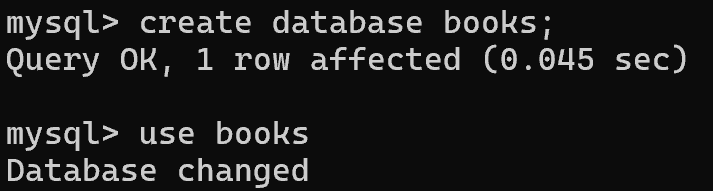
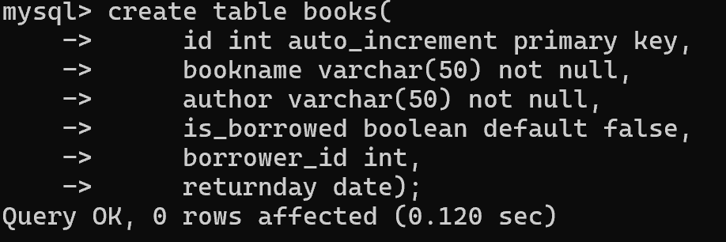
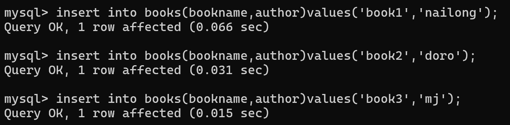
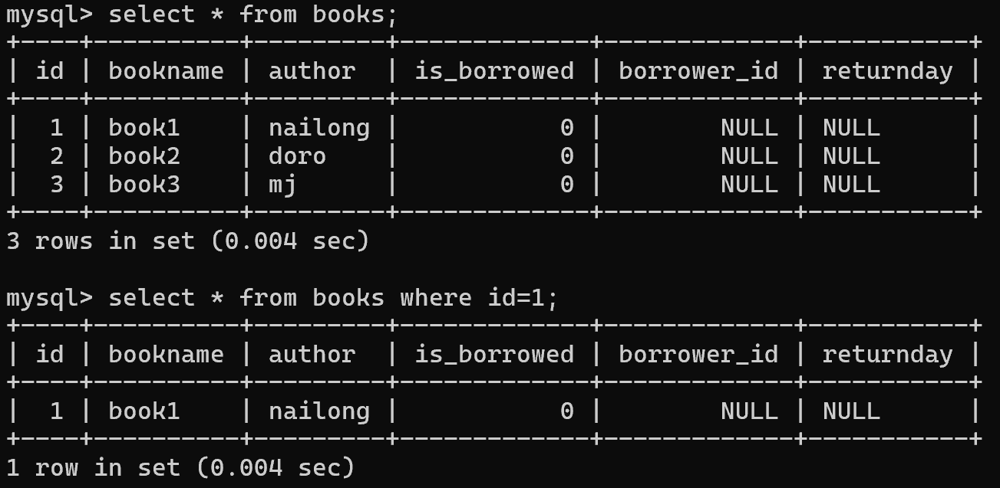
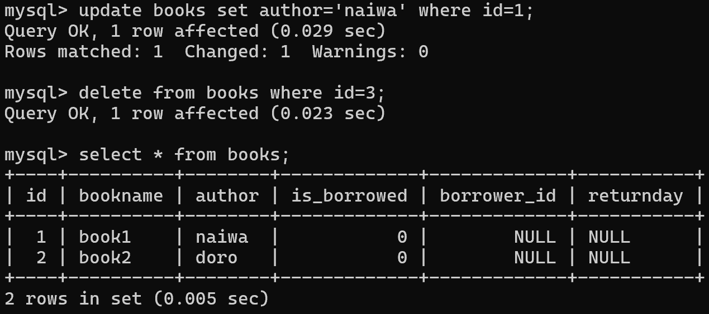

# ans
## task1

## task2

## task3

- ##### 你是否选择了某个字段作为唯一标识？为什么选择该字段作为唯一标识？

我选了id字段，因为 id 是专门为每条记录分配的代理键，跟书籍的业务属性没关系，稳定且唯一，适合作为主键。

- ##### 如果存在两本书籍名称相同的情况，数据库应该如何区分这两条记录？

通过id区分，因为id是主键，具有唯一且非空约束，不同的书有不同的id。

##### 附上你自己对 Mysql 本身特点的理解（比如：他的优点在哪？他有没有缺点？什么地方适合使用…）

他的优点：开源免费，网上教程多，安装和使用都挺简单的，简单查询的速度快。

他的缺点：复杂查询能力比较差。

适合使用：web应用，中小型系统，读多写少的系统，oltp业务。