# part2
## ans

#### docker --version
#### docker run hello-world
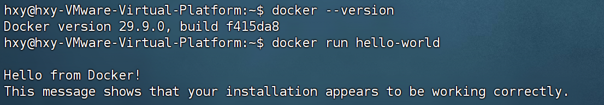
#### docker run -d -p 8080:80 nginx:alpine
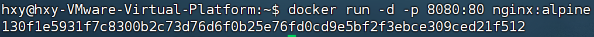

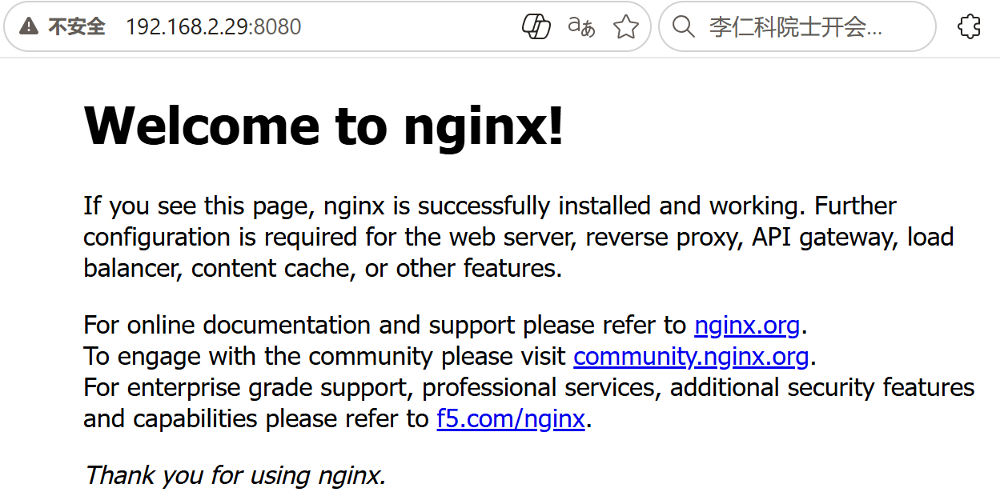
#### docker ps
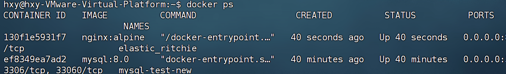
#### docker stop <容器ID>
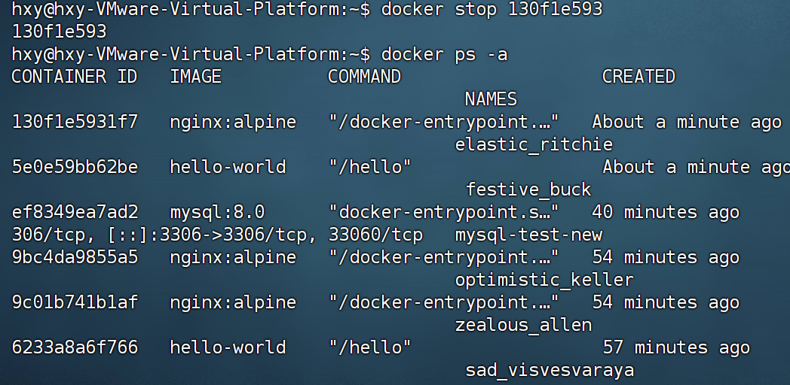
#### 用自己的话解释一下：镜像和容器到底有什么区别
镜像类似java里的类，是一个只读模板，docker根据这个模板来创建容器。
容器类似对象，是动态的运行程序，包含各种数据。
#### 获取与部署
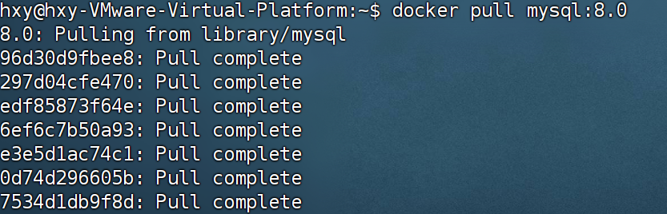
#### 数据持久化
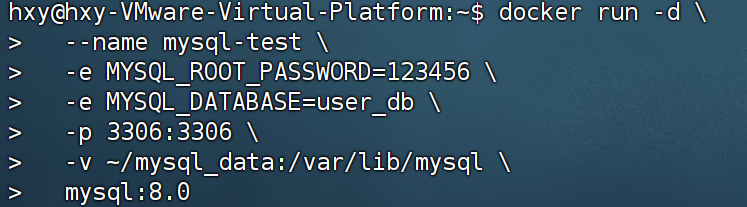
#### 连通验证与落库
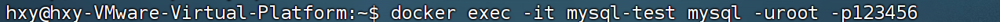
#### 
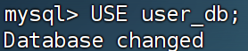
#### 
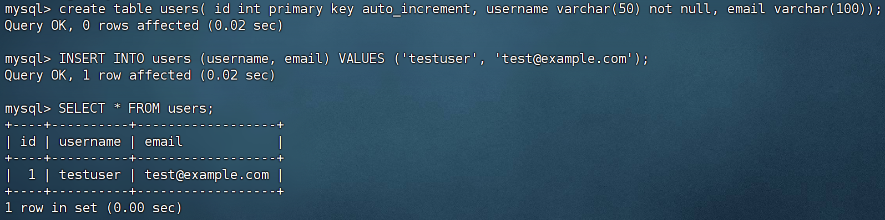
#### 删除验证
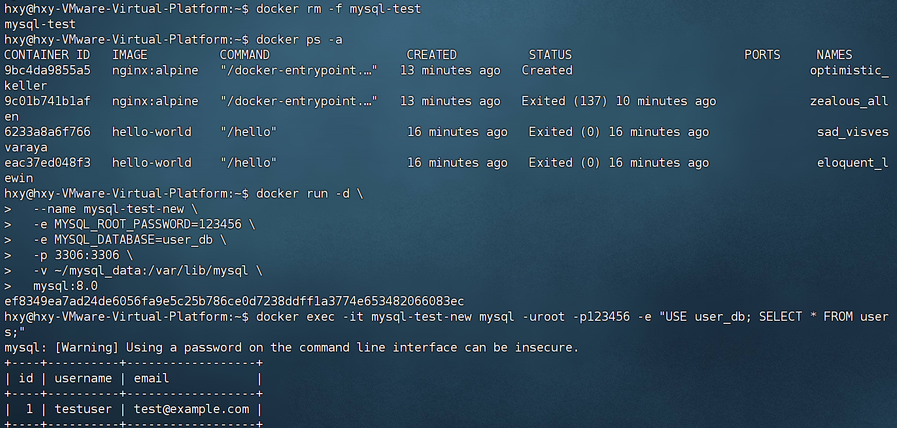

#### 总结你在哪个环节出了最多的问题，如果你是出题人，你会怎么去考察学习者对docker的掌握程度？

我在配置环境环节出了最多的问题，docker安装时有很多方法，我一开始用的snap安装，但后续操作会很麻烦，又换成通过官方docker仓库安装，但安装时出现网络问题，最后用的国内的镜像源。

如果我是出题人，我会先考察一部分基础概念问题，然后考察基本的容器生命周期管理，比如拉取、启动、关闭、删除，最后考察数据持久化。