# part4

- ##### HTTP 是什么？解决了什么问题？
http是一种数据通信协议。解决了不同系统之间资源传输的问题。
- ##### 请你对常见的状态码进行了解并进行总结
1xx：信息，继续。
2xx：成功。
3xx：重定向或缓存。
4xx：客户端错，通常是请求方问题。
5xx：服务器错，通常是服务端或上游问题。

## task1
- ##### 思考：客户端与服务器之间的数据交换是否需要遵循某种统一规范？
需要，不然客户端不知道该如何向服务器请求资源，服务器也无法以客户端可以解析的格式返回资源。

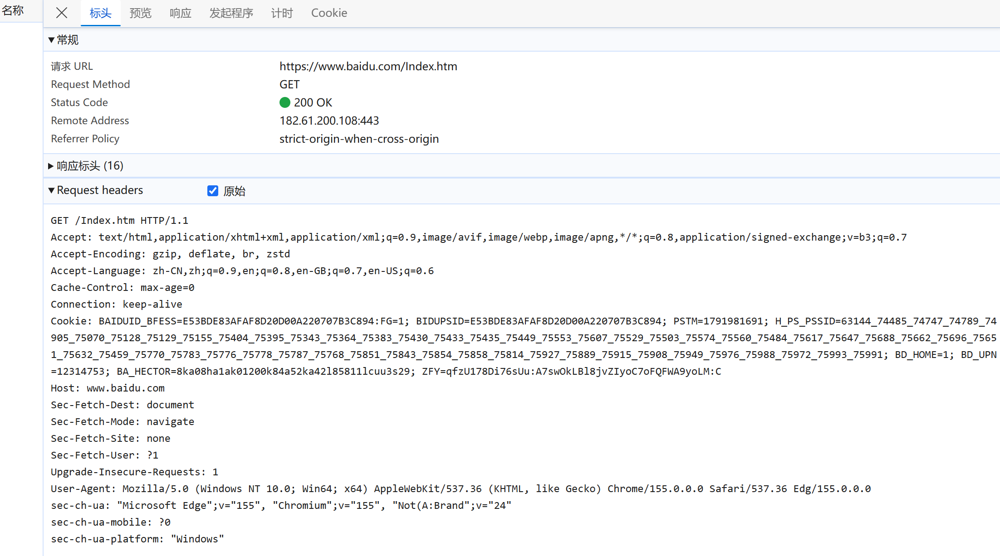
- ##### 请求使用的 Method 是什么？
GET
- ##### 请求 Header 中有哪些信息？
Host：服务器域名
Accept：客户端可以接收的文件类型。
Accept-Encoding：客户端支持的压缩算法
Accept-Language：客户端偏好的语言
Connection：是否保持tcp连接
Cookie：服务器给的，用来识别身份和跟踪会话。
User-Agent：客户端浏览器类型。
- ##### 服务器返回了什么内容？
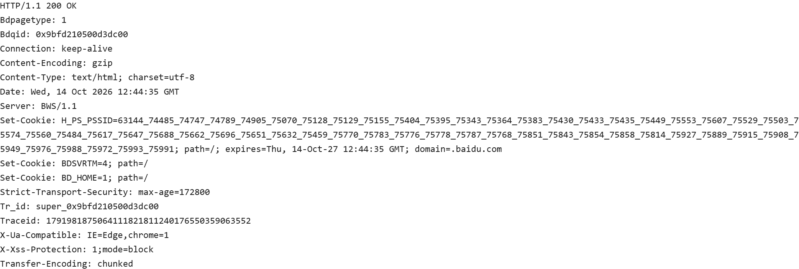
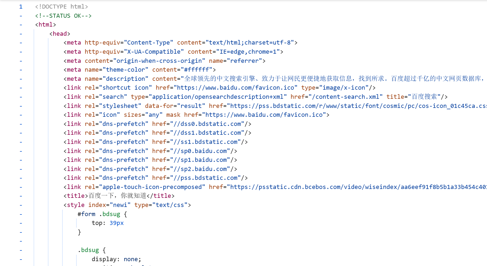
返回了响应头和响应体。
响应头里有响应的相关信息，比如`Content-Type`内容的格式，`Set-Cookie`服务器设置的cookie。
响应体里是html文件。
- ##### 一次 HTTP 请求通常包含哪些部分？分别有什么作用？
包含请求信息和响应信息。
请求信息由请求行、请求头、空行、请求体组成。
1. 请求行包含请求方法、资源路径、http版本。
2. 请求头包含一些由键值对表示的附加信息，比如客户端接收的文件类型，支持的压缩算法，cookie之类的。
3. 空行表示请求头结束。
4. 请求体里如果是post方法就是数据、get方法就是空的。

响应信息由响应行、响应头、空行、响应体组成。
1. 响应行包含http版本、状态码、状态描述。
2. 响应头包含响应的元信息，比如内容类型、内容长度、服务器信息等。
3. 空行表示响应头结束。
4. 响应体包含服务器响应的数据，比如html文件、图片等。
- ##### 请了解并总结常见 HTTP 请求方法，以及它们通常用于什么场景。
1. get：获取资源，场景：浏览网页、搜索。
2. post：提交资源，场景：上传文件、提交表单。
3. put：修改资源，场景：修改用户信息。
4. patch：部分修改资源，场景：修改用户昵称。
5. head：获取和get方法一样的响应头，但没有响应体，场景：检查资源是否存在、获取文件大小。
6. delete：删除资源，场景：删除用户、文章。
7. options：查询目标资源支持的通信选项，场景：跨域请求前的预检。

## task2 修改请求 Header
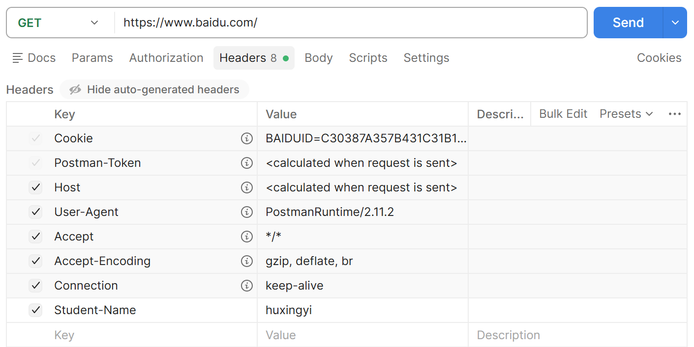
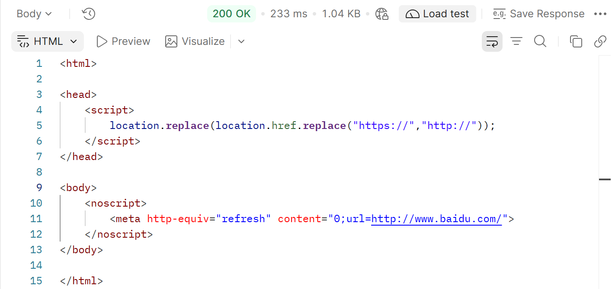

##### 为什么 HTTP 请求需要 Header？
header用于传递请求的附加信息，能让服务器理解请求，认证身份，识别数据，控制行为等。
##### 如果 HTTP 请求没有 Header，服务器还能正常处理所有请求吗？有没有例外情况？
不能，如果请求用的协议不要求请求头，服务器也不需要请求头携带信息，则服务器能够正常处理这个请求。
##### 除了 Student-Name 外，你还能想到哪些常见 Header？它们分别有什么作用
host：指定请求的主机。
user-agent：描述客户端。
accept：客户端希望接收的数据格式。
Accept-Language：客户端偏好的语言。
content-type：请求体的格式。
content-length：请求体的字节长度。

## task3 发送 POST 请求提交数据
### Task3-1：发送普通文本
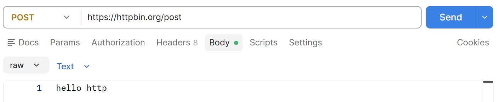
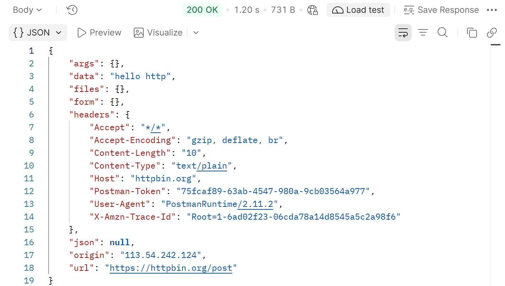
### Task3-2：发送 JSON 数据
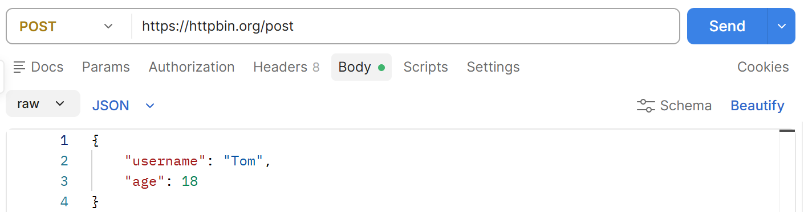
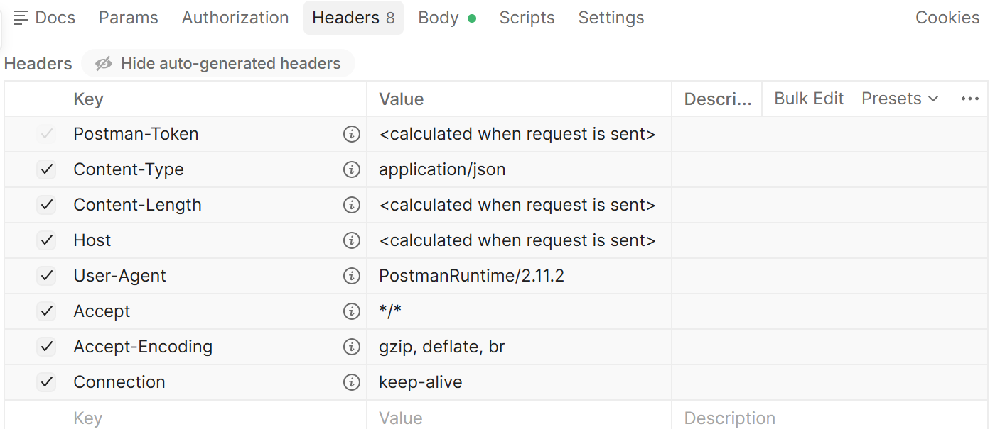
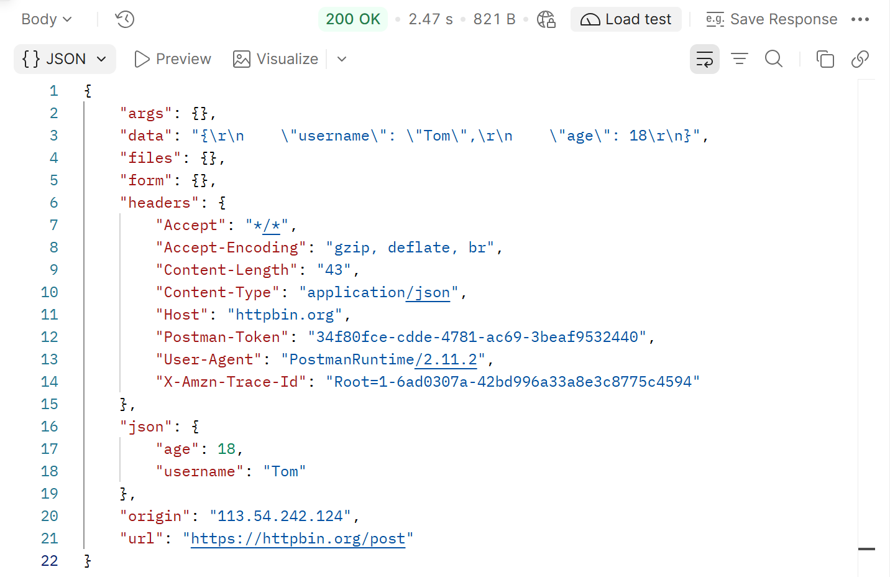

##### 为什么提交数据时通常使用 POST 请求，而不是 GET 请求？
http定义了不同请求方法的语义。get请求是获取指定资源；post请求是向服务器提交数据。
##### 为什么发送 JSON 数据时需要设置：`Content-Type: application/json`
因为服务器需要知道请求体的数据是什么格式，才能选择合适的解析方式。
##### 如果不设置 Content-Type，服务器还能收到数据吗？还能正确解析数据吗？
能收到数据。
能否解析取决于服务器的实现方式，如果服务器严格根据`Content-Type`选择解析器则不能解析，如果服务器可以根据其他的规则判断数据格式，则有可能正确解析。

## task4 模拟一个简单登录请求
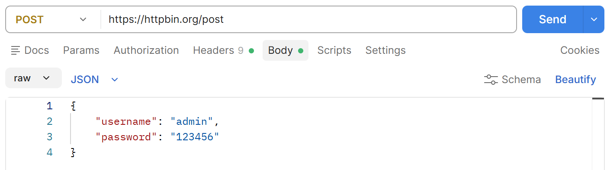
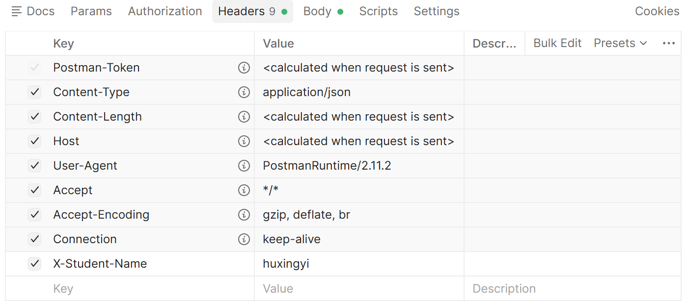
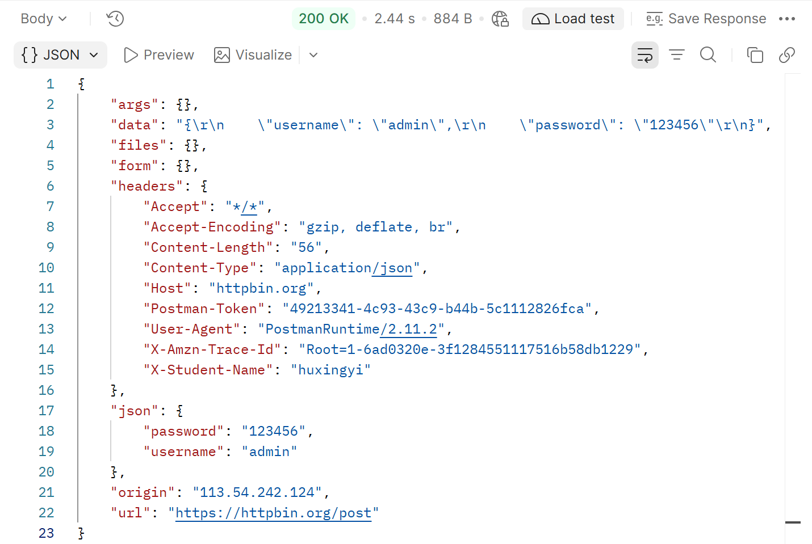

##### 为什么登录请求通常使用 POST，而不是 GET？
因为登录时需要向服务器提交数据，符合post的语义。
##### 为什么需要设置 Content-Type: application/json？
因为要告诉服务器请求体中数据的格式，方便服务器进行解析。
##### 用户名和密码是否应该直接放在 URL 中？为什么？
不应该，因为url会被保留在浏览器浏览历史、服务器日志等位置，会导致用户名和密码泄露。

## 拓展思考题
##### 你在某网站点击“获取短信验证码”后，因为网络卡顿页面没有反应，你连续快速点击了 5 次按钮。几秒钟后收到 5 条验证码，但只有最后一次验证码有效，导致用户无法判断应该输入哪个验证码。现在回答下面的问题：

- #### 为什么“获取验证码”通常使用的是 POST 请求而不是 GET 请求？
因为获取短信验证码需要服务器执行一些操作，而post可以提交数据并触发服务器端的处理操作。get方法应该是安全、幂等的。
- #### 如果用户多次重复发送同一个 HTTP 请求，为什么 GET 请求通常不会造成问题，而 POST 请求可能会产生问题？
安全性：请求不应要求服务器执行修改业务状态的操作。
幂等性：相同请求执行一次或多次，预期效果相同。
get请求应该被设计为安全、幂等的，而post不需要保证这两点。
- #### 后端可以采用什么手段防止这种因为 HTTP 请求重复发送带来的问题？
重复请求可以通过限流、幂等键、验证码覆盖规则和前端防重复点击等方式处理。
- #### 在你在某网页提交报名表时，由于网络问题网页没有响应，此时你点击刷新，看到了浏览器跳出的弹窗警告：确认重新提交表单 / Confirm Form Resubmission，请问为什么需要如此设计？
刷新页面时出现表单重新提交提示，是因为刷新时浏览器可能需要重新发送之前的 POST 请求，而服务器可能已经处理过第一次提交。PRG 模式可以减少刷新导致的重复提交。
- #### 一个网页上的图片、CSS、JavaScript 文件，是不是也通过 HTTP 请求获取的？
是。